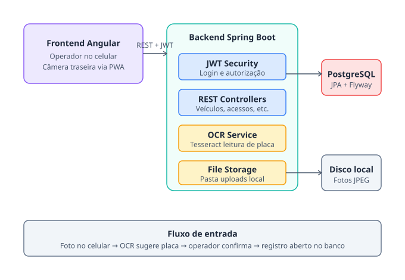

# 🅿️ Sistema de Gestão de Estacionamento

Sistema web completo para controle de estacionamento com captura de placa via OCR, construído como projeto de estudo/portfólio.

O operador, pelo celular, fotografa o veículo na entrada; o sistema reconhece a placa automaticamente, sugere ao operador para confirmação, e registra a entrada. Na saída, calcula a tarifa automaticamente — ou zera se o veículo for de mensalista.

## ✨ Funcionalidades

- 🔐 Autenticação JWT com papéis ADMIN e OPERADOR
- 📸 Captura de foto pela câmera traseira do celular
- 🤖 Leitura automática de placa via OCR (Tesseract)
- 🚗 CRUD de veículos e mensalistas
- ⏱️ Controle de entrada/saída com cálculo automático de tarifa
- 💳 Mensalistas com tarifa zerada
- 📊 Listagem em tempo real dos veículos no estacionamento
- 📱 Interface mobile-first (operador usa pelo celular)
- 🗄️ Migrations versionadas com Flyway
- 📖 API documentada com Swagger/OpenAPI

## 🏗️ Arquitetura



**Stack:**

- **Frontend:** Angular 18 (standalone components, signals), TypeScript, SCSS
- **Backend:** Spring Boot 3.2, Java 17, JPA/Hibernate, Spring Security, Flyway
- **Banco:** PostgreSQL 16
- **OCR:** Tesseract via Tess4J
- **Autenticação:** JWT (jjwt 0.11.5)

## 📋 Pré-requisitos

- Java 17+
- Maven 3.8+
- Node.js 20+ e npm
- PostgreSQL 16 (nativo ou via Docker)
- Tesseract OCR instalado no sistema

## 🚀 Como rodar

### 1. Banco de dados

**Opção A — PostgreSQL nativo (recomendado em máquinas com pouca RAM):**

```bash
sudo apt install -y postgresql postgresql-contrib
sudo systemctl enable --now postgresql

sudo -u postgres psql << 'EOF'
CREATE USER estacionamento WITH PASSWORD 'estacionamento';
CREATE DATABASE estacionamento OWNER estacionamento;
GRANT ALL PRIVILEGES ON DATABASE estacionamento TO estacionamento;
EOF
```

**Opção B — Docker:**

```bash
cd estacionamento-backend
docker compose up -d
```

### 2. Tesseract OCR

```bash
# Ubuntu/Debian/Mint
sudo apt install -y tesseract-ocr libtesseract-dev

# macOS
brew install tesseract

# Fedora
sudo dnf install tesseract tesseract-langpack-eng
```

Descubra o caminho do tessdata e ajuste em `estacionamento-backend/src/main/resources/application.yml` (chave `app.ocr.tessdata-path`):

```bash
find /usr/share -name "eng.traineddata" 2>/dev/null
```

### 3. Backend

```bash
cd estacionamento-backend
mvn spring-boot:run
```

Sobe em `http://localhost:8080`. Swagger em `http://localhost:8080/swagger-ui.html`.

### 4. Frontend

Em outro terminal:

```bash
cd estacionamento-frontend
npm install
npx ng serve
```

Acesse `http://localhost:4200`.

### 5. Login

Migration de seed já cria o usuário admin:

- **email:** `admin@estacionamento.local`
- **senha:** `admin123`

## 📡 Principais endpoints

| Método | Endpoint | Descrição | Acesso |
|--------|----------|-----------|--------|
| POST | `/api/auth/login` | Autenticação | Público |
| GET | `/api/veiculos` | Listar veículos | Autenticado |
| POST | `/api/veiculos` | Criar veículo | Autenticado |
| GET | `/api/mensalistas` | Listar mensalistas | ADMIN + OPERADOR |
| POST | `/api/mensalistas` | Criar mensalista | ADMIN |
| POST | `/api/usuarios` | Criar operador | ADMIN |
| GET | `/api/acessos?abertos=true` | Veículos no estacionamento | Autenticado |
| POST | `/api/acessos/entrada` | Registrar entrada (multipart) | Autenticado |
| POST | `/api/acessos/{id}/saida` | Registrar saída (multipart) | Autenticado |
| POST | `/api/ocr/reconhecer` | Preview do OCR | Autenticado |

## 🗂️ Estrutura do projeto

```
.
├── estacionamento-backend/
│   ├── src/main/java/com/estacionamento/
│   │   ├── config/          # Security, CORS, OpenAPI, recursos estáticos
│   │   ├── controller/      # REST controllers
│   │   ├── dto/             # DTOs de request/response
│   │   ├── exception/       # Exceções e handler global
│   │   ├── model/           # Entidades JPA
│   │   ├── repository/      # Spring Data
│   │   ├── security/        # JWT
│   │   └── service/         # Lógica de negócio (incluindo OCR)
│   ├── src/main/resources/
│   │   ├── application.yml
│   │   └── db/migration/    # Migrations Flyway
│   ├── docker-compose.yml
│   └── pom.xml
│
└── estacionamento-frontend/
    ├── src/app/
    │   ├── core/            # Models, services, interceptors, guards
    │   ├── features/
    │   │   ├── auth/login/  # Tela de login
    │   │   ├── portaria/    # Tela principal (entrada/saída com câmera)
    │   │   ├── veiculos/    # CRUD de veículos
    │   │   └── mensalistas/ # CRUD de mensalistas
    │   ├── layout/shell/    # Layout com sidebar
    │   └── shared/
    │       ├── components/camera-capture/  # Componente de câmera
    │       └── directives/                 # Máscara de moeda
    ├── angular.json
    └── package.json
```

## 🎯 Fluxo principal (Portaria)

1. Operador toca em **Registrar entrada**
2. Ativa a câmera traseira do celular
3. Captura a foto do veículo
4. Backend faz OCR e devolve a placa sugerida
5. Operador confere/ajusta a placa e confirma
6. Registro é criado com status `ABERTO`

Na saída, o operador seleciona o registro aberto na lista, captura nova foto, e o valor é calculado automaticamente (ou zerado se for mensalista). Tem tolerância configurável (padrão 15 minutos).

## 📷 Sobre a câmera

A API `getUserMedia` do navegador só funciona em **contextos seguros**: HTTPS ou `localhost`. Para testar pelo celular durante o desenvolvimento:

- Acesse via `http://localhost:4200` na mesma máquina, ou
- Use `ngrok http 4200` para ter HTTPS automático, ou
- Configure `ng serve --ssl` com certificado autoassinado

## 🤖 Sobre o OCR

A implementação atual usa **Tesseract puro**, que não foi feito para detectar placas em cenas abertas — ele espera texto já recortado. A precisão em fotos de celular sem pré-processamento é baixa, então o campo da placa vem editável para o operador corrigir.

Para um sistema de produção, recomendo trocar o `TesseractOcrService` por uma destas opções (a interface `OcrService` foi pensada para essa troca ser uma classe só):

- **[OpenALPR](https://github.com/openalpr/openalpr)** — open source, específico para placas
- **[Plate Recognizer](https://platerecognizer.com/)** — SaaS pronto com suporte ao padrão brasileiro
- **Google Cloud Vision API** — texto em imagem
- **AWS Rekognition** (DetectText)

## ⚙️ Configuração

`application.yml` no backend permite ajustar:

```yaml
app:
  jwt:
    secret: troqueEstaChave...
    expiration-ms: 28800000        # 8 horas
  upload:
    dir: ./uploads
  tarifa:
    valor-por-hora: 8.00
    tolerancia-minutos: 15
  ocr:
    tessdata-path: /usr/share/tesseract-ocr/4.00/tessdata
    idioma: eng
```

## 🛣️ Roadmap / Próximos passos

Funcionalidades que poderiam ser adicionadas:

- [ ] CRUD de usuários/operadores no frontend (endpoint já existe)
- [ ] Fluxo de "esqueci minha senha" via e-mail
- [ ] Relatório de faturamento por período
- [ ] Exportação de registros em CSV/PDF
- [ ] Substituir Tesseract por OpenALPR/Plate Recognizer
- [ ] Dashboard com métricas (rotatividade, ticket médio)
- [ ] Notificações em tempo real (WebSocket) quando outro operador registra acesso
- [ ] Containerização completa (Dockerfile do backend e do frontend)
- [ ] Testes automatizados (JUnit + Karma/Jasmine)

## 📝 Licença

Projeto pessoal de estudo. Sinta-se livre para usar como referência.

---

Construído como exercício de stack fullstack moderna: Angular 18 + Spring Boot 3 + PostgreSQL, com integração OCR e captura de mídia via navegador.
